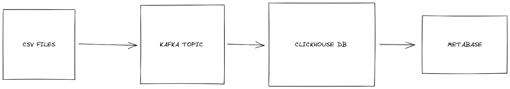

# Jobsity Data Engineer Challenge

## Overview

The challenge was to build a data pipeline that processes CSV files automatically, on demand. The approach:

- A Python CLI processes any file in the `data` folder and turns every row into a Kafka message.
- Messages go to a Kafka topic and are consumed into ClickHouse, a columnar database built for analytical workloads.
- A Metabase server sits on top, ready for the analytics team.

To run it, install Docker and Docker Compose, then run `docker compose up`.

Then, to test the ingestion itself, run `python data-ingestion.py`.

I couldn't run the full dataset locally because of disk and RAM limits; in the cloud, the solution scales out by adding Kafka nodes.

## Cloud Solution

The cloud version wouldn't be very different: the Kafka topic would land directly in a data lake (S3, for instance) and Spark on EMR would process the messages, while the final destination and the visualization tool stay the same.

## Bonus questions

The answers are in `requested_queries.sql`.
